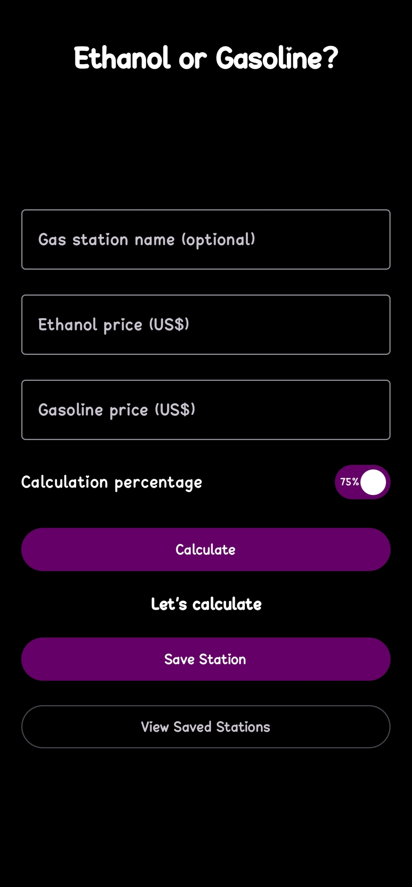
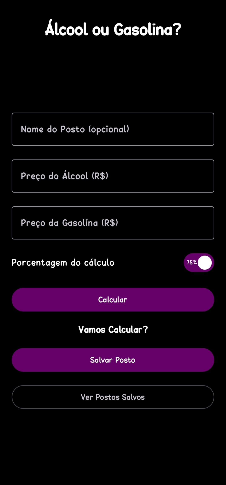
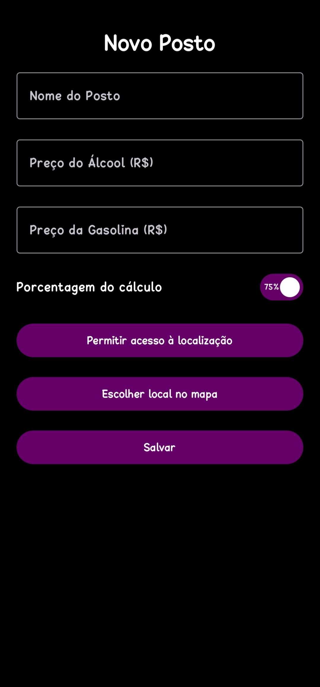
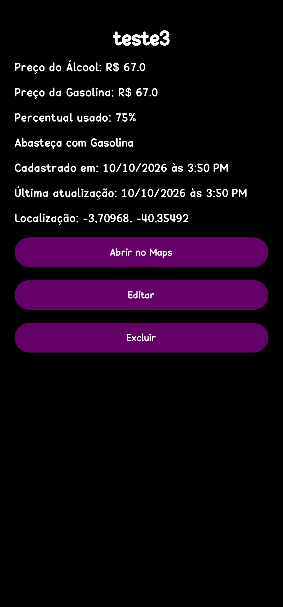
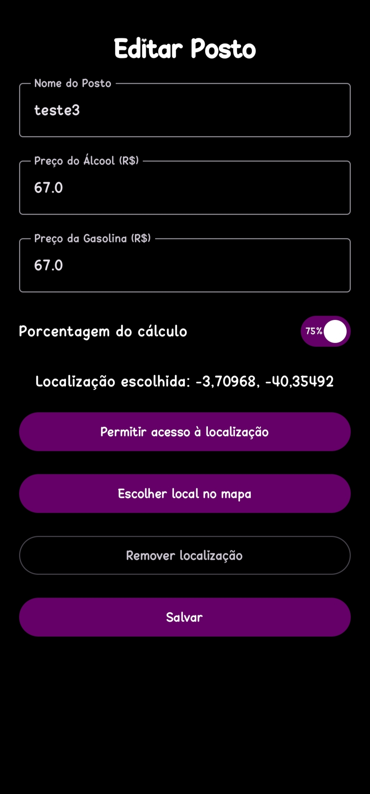
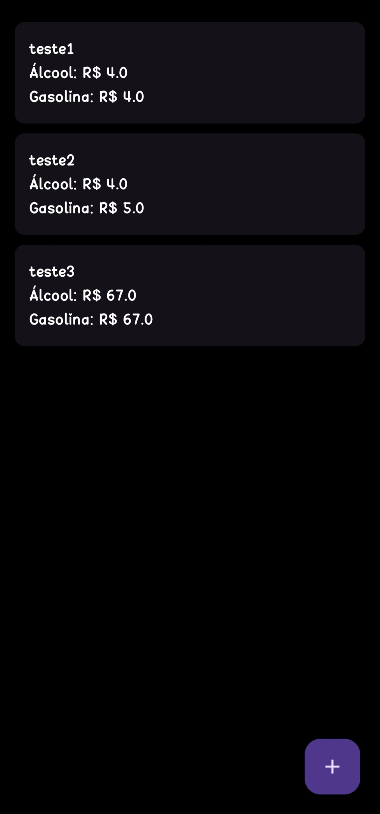

# Álcool ou Gasolina?

Esta é uma das dúvidas mais recorrentes na hora do abastecimento veícular. O etanol só compensa se estiver custando por volta de 70-75% do valor da gasolina. Porém, fazer contas manualmente gasta bastante tempo. Graças a este app, seus problemas ACABARAM! 

- Insira os valores de cada um dos combustíveis e qual a porcentagem de corte e veja instantâneamente qual das opções compensa mais.
- Salve seus postos favoritos e atualize seus valores conforme eles mudarem
- Adicione uma localização para cada posto. Se você não sabe onde está abastecendo, ligue o localizador e não perca os postos que descobrir em suas jornadas
- Algum posto não lhe atende bem? Exclua-o da lista!

### Como instalar?

  Acesse as [releases](https://github.com/Xynel0/Alcool-ou-Gasolina/releases) e procure a mais recente. Descendo a tela para baixo, você deve localizar um arquivo '.apk' e clicar sobre ele. Autorize a instalação em seu android e seja feliz!

    
    
    
    
    
    

<video src="https://github.com/user-attachments/assets/96be06a6-7392-4ad6-9a03-8cf4ea92fa8f">
</video>

Made with ♡
